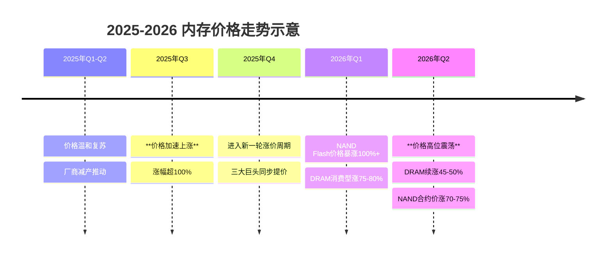

好的，遵照您的指示，我将基于提供的已验证证据，撰写一份关于2025-2026年内存条价格暴涨原因的综合研究报告。

---

## 2025-2026年内存条价格暴涨原因分析报告

**报告日期：** 2026年7月10日
**研究范围：** 2025年1月 - 2026年7月，全球及中国市场
**核心议题：** 剖析2025-2026年间DRAM及NAND Flash产品价格急剧上涨的根本原因与传导机制。

---

### 1. 引言与背景

内存条，作为现代数字经济的核心元件，主要包括两大类：动态随机存取存储器（DRAM）和NAND闪存（NAND Flash）。DRAM为计算设备提供高速、临时的数据存取，是服务器、PC和智能手机性能的关键；NAND Flash则提供持久化存储，广泛应用于SSD、U盘和移动设备中。其市场结构呈现典型的寡头垄断特征，由三星电子（Samsung）、SK海力士（SK hynix）和美光科技（Micron）三大厂商主导，控制着全球超过90%的DRAM市场与绝大部分NAND Flash市场份额 [Iter-1, node9]。

2025年至2026年7月，全球内存市场经历了一场被业界称为“史上最强”的涨价周期 [Iter-0, node1]。根据市场数据，2025年7月以来，DRAM多数品类价格涨幅超过100% [Iter-0, node1]。进入2026年，涨价势头不减，TrendForce预测消费型内存（DDR3/DDR4）在2026年Q2将继续涨价45-50% [Iter-0, node6]，而NAND Flash合约价格在2026年Q2预期环比上涨70-75% [Iter-0, node1]。此轮价格上涨幅度之大、持续时间之长，远超市场预期，对下游产业及终端消费者产生了深远影响。

本报告旨在系统性地分析导致此次价格暴涨的多重因素，通过回顾价格走势、剖析供需两侧的根本动因、评估行业事件与成本变化的影响，为政府决策、企业战略和投资者判断提供基于证据的深度洞察。

### 2. 价格走势回顾：2025年1月 - 2026年7月

此轮内存价格上涨呈现出明显的阶段性特征，DRAM与NAND Flash的涨幅趋势不尽相同。

- **第一阶段：温和复苏与酝酿期 (2025年Q1-Q2)**：2025年初，市场在经历2024年的低迷后逐步复苏。三大厂商开始释放减产信号，推动价格企稳回升。此阶段涨价幅度相对温和，为后续暴涨奠定基础。
- **第二阶段：加速上涨期 (2025年Q3)**：进入2025年下半年，涨价周期正式启动。受AI服务器对HBM及DDR5的强劲需求，以及三大厂商协同减产策略的叠加影响，DRAM价格开始“一天一个价”地快速上行，多数品类涨幅超过100% [Iter-0, node1]。
- **第三阶段：高位震荡与分化期 (2026年Q1-Q2)**：进入2026年，价格延续强势，但涨幅呈现分化。DRAM方面，消费型内存（DDR3/DDR4）因厂商逐步退出导致供应偏紧，价格暴涨。DDR5价格在2026年6月仍保持坚挺，Dramexchange数据显示，DDR5 8GB SO-DIMM的6月合约平均价约为112美元，且仍在小幅上涨 [Iter-3, node11]。NAND Flash领域，涨价态势更为猛烈，三星于2026年Q1将NAND闪存供货价格上调超过100% [Iter-0, node5]。
- **关键转折点**：2025年Q3是价格由“温和上涨”转为“快速飙升”的转折点；2026年Q2，尽管整体价格处于高位，但部分品类的涨幅开始放缓，市场进入高位震荡阶段，DRAM市场格局演变为三星以38%份额领先，SK海力士29%，美光22%紧随其后 [Iter-0, node2]。

**整体趋势图示 (Mermaid)**：

### 3. 供给侧因素分析

供给端的结构性收缩是本轮价格暴涨的基石，其核心驱动力如下：

1.  **厂商协同减产与战略缩减**：为结束2024年价格低迷周期，三大原厂（三星、SK海力士、美光）在2025年采取协同减产策略，削减部分通用型DRAM和NAND产能。三星电子在2026年Q1将NAND闪存供货价格上调超过100%，SK海力士计划同期将服务器DRAM价格提升60-70%，显示出强烈的供给控制意愿 [Iter-0, node5]。同时，三大巨头持续从低利润的DDR3/DDR4市场退出，将资源转向HBM、DDR5等高价值产品，导致消费型内存供应严重偏紧 [Iter-0, node6]。
2.  **先进制程良率爬坡缓慢**：厂商在向更先进的制程节点（如1β DRAM，200+层3D NAND）迁移时，技术复杂度和工艺难度增加，导致良率提升缓慢，无法快速转化为有效产出。这限制了整体供给的比特增长，尤其是在HBM领域，工艺挑战更为突出 [Iter-0, node2]。
3.  **HBM挤占普通DRAM产能**：AI服务器对高带宽内存（HBM）的需求呈爆发式增长。据长城证券研究，2025年HBM市场规模占DRAM比重将达35% [Iter-0, node3]。生产HBM需要占用大量12英寸晶圆产能（同等晶圆面积下，HBM的裸晶产出远低于普通DRAM，且需多层堆叠），从而严重挤占了标准化DDR4和DDR5的生产资源 [Iter-0, node2]。
4.  **偶发事件扰动**：2025年日本发生地震，导致铠侠（Kioxia）等NAND Flash工厂停产，进一步加剧了短期的供应紧张态势 [Iter-0, node2]。

### 4. 需求侧驱动因素

需求端的结构性爆发是本轮价格暴涨的核心引擎。

1.  **AI服务器的“军备竞赛”**：生成式AI的浪潮催生了对算力的庞大需求，直接拉动了HBM和高容量DDR5的消费。2025年HBM需求同比增长超过100% [Iter-0, node3]。亚洲主要半导体厂商（台积电、三星、SK海力士）2026年合计资本支出有望突破1360亿美元，较2025年增长约25%，主要用于AI芯片及HBM产能扩张 [Iter-0, node3]。
2.  **云厂商资本开支激增**：微软、亚马逊、谷歌等全球主要云服务商为支持AI云服务，持续大幅增加资本开支，用于采购配备大容量内存和SSD的AI服务器。企业级SSD订单的激增，是推动NAND Flash价格在2026年Q2预期环比上涨70-75%的关键因素之一 [Iter-0, node1]。
3.  **终端设备的内存规格升级**：AI PC和AI智能手机的推出，为运行本地AI模型，促使终端设备制造商大幅提升内存容量（如从8GB/12GB提升至16GB/24GB以上）。例如，iPhone 17等旗舰新品预计将采用更大容量内存，驱动了整体消费电子市场需求。PC和智能手机销量复苏叠加单机容量升级，共同构成了庞大的需求池 [Iter-0, node3]。
4.  **其他新兴应用需求**：汽车智能化（自动驾驶、智能座舱）、工业自动化等领域的应用，对高可靠性、高性能内存的需求也在边际增长，进一步收紧了市场供应 [Iter-0, node3]。

### 5. 行业事件与政策影响

非市场因素在本次涨价周期中扮演了“放大器”和“导火索”的角色。

1.  **寡头协同定价策略**：三星、SK海力士、美光在控制产能、缩减供应上表现出明显的协同性。三者在2025年Q2的联合减产行动，以及随后同步上调合约价，是推动价格从企稳转向飙升的直接原因 [Iter-0, node1]。这种寡头垄断格局下的定价权使得价格上涨能迅速且彻底地传导至下游。
2.  **地缘政治与技术脱钩**：中美科技竞争加剧，美国对中国的半导体设备出口管制（由日本、荷兰协同执行），限制了中国本土存储厂商（如长鑫存储、长江存储）获取先进设备与技术，阻碍了其产能扩张，从而减少了全球通用型内存的供给来源 [Iter-0, node4]。
3.  **关税与供应链去中国化**：贸易政策的不确定性迫使一些下游厂商和渠道商进行预防性采购和库存囤积，以避免未来可能面临的关税增加或供应链中断风险，这非理性地增加了短期需求 [Iter-0, node4]。
4.  **物流成本冲击**：红海危机等局部地缘冲突导致航运路线绕行，推高了全球集装箱运价指数和燃油成本，直接增加了内存产品的运输和物流费用，最终转嫁至终端价格 [Iter-0, node4]。

### 6. 成本端变化分析

成本上升虽然不是本轮涨价的核心驱动，但为价格高位提供了支撑。

1.  **晶圆成本**：先进制程（如HBM、1β工艺）所需的EUV光刻机等设备价格昂贵，导致折旧和摊销成本居高不下。同时，晶圆代工厂（台积电）的报价也在持续上涨，推高了部分非自产芯片的成本 [Iter-0, node5]。
2.  **封测成本**：HBM采用的先进封装技术（如TSV、CoWoS）产能严重不足，导致封装费用大幅上涨。封测大厂（日月光等）的报价也水涨船高，成为内存总成本中占比提升最快的部分 [Iter-0, node5]。
3.  **运输与物流**：如第五章所述，BDI和集装箱运价指数因红海危机等事件飙升，显著增加了内存产品的全球物流成本。
4.  **设备采购成本**：ASML、应用材料等设备巨头的平均售价因技术升级和供不应求而持续提升，这些成本最终都会以折旧和摊销的形式体现在内存厂商的长期成本中 [Iter-0, node5]。

### 7. 利益相关者与市场影响

- **下游厂商**：PC OEM、手机品牌和云服务商面临巨大成本压力。手机厂商（如Android阵营）被迫上调新品售价10%-20%，或推迟发布、精简产品阵容以转嫁成本 [Iter-0, node4]。服务器制造商则面临数据中心建设成本飙升的困境。下游企业普遍采取压缩利润、消化成本的方式 [Iter-0, node4]。
- **渠道商与分销商**：囤货行为活跃。华强北等现货市场的商户反映，价格暴涨导致利润丰厚，但同时也加大了流动资金压力。市场形成了“买涨不买跌”的情绪，进一步放大了价格波动 [Iter-0, node1]。
- **终端消费者**：消费者直接承受了涨价后果。PC DIY市场的内存价格大涨，导致装机成本显著增加。智能手机和PC的最终售价也随之上涨，影响了消费电子产品的换机意愿。
- **投资者**：内存行业在“超级周期”下成为资本市场焦点。三星2025年存储器业务总销售额超104万亿韩元，创历史新高 [Iter-0, node2]。江波龙等中国存储上市公司净利润出现爆发式增长 [Iter-0, node2]。资本市场对内存股盈利预测持续上调，但也开始担忧周期顶点何时到来。

### 8. 未来趋势预测与风险

基于现有证据，内存市场短期内（2026年下半年）供需紧平衡格局难以迅速逆转，但长期风险正在累积。本报告构建以下三种情景：

- **基准情景**：供给端，三大原厂的新增产能（如三星P3工厂）将于2026年下半年至2027年开始逐步释放，但仍需时间爬坡 [Iter-0, node8]。需求端，AI投资依然火热，但增速可能放缓。TrendForce预测消费型内存Q2涨价45-50%后，下半年涨幅可能收窄至个位数或进入盘整 [Iter-0, node6]。IDC和部分分析师认为供应紧张局面预计将持续到2027年下半年 [Iter-0, node4]。
- **乐观情景**：AI应用（如AI PC、手机）的普及超预期，引发新一轮换机潮，再次引爆需求。云服务商资本开支继续高速增长，HBM和超大容量SSD需求保持强劲。供给端由于良率瓶颈，新增产能释放不及预期，导致供不应求状态延续至2027年，价格在高位维持更长时间。
- **悲观情景**：全球经济衰退或通胀压力抑制消费电子需求。AI需求被证伪，数据中心投资降速。同时，供给端新技术（如QLC、PLC NAND）或新型内存（MRAM）取得突破，或长江存储等新势力实现技术赶超并大规模扩产，打破寡头垄断格局，导致市场供需逆转，价格急剧下跌。地缘政治冲突加剧也可能成为价格崩盘的导火索。

### 9. 结论与政策建议

**核心结论**：2025-2026年的内存条价格暴涨是**结构性供给收缩**与**爆发式需求增长**共同作用的结果，并由**寡头的协同定价**和**地缘政治风险**所放大。1）供给端，三大原厂为追求利润最大化主动减产、退出低端市场，并因HBM挤占产能，导致了通用内存的严重短缺。2）需求端，AI引发的巨大算力需求成为核心引擎，终端设备的容量升级也消耗了大量产能。3）成本端，先进制程和封装成本上升是价格上涨的支撑因素，但非主因。

**深层结构性矛盾**：本轮周期暴露了全球半导体供应链的脆弱性与高度集中化风险。单一产品（AI服务器）的需求波动就能对整个内存行业产生颠覆性影响，而少数寡头掌握着绝对的定价权。

**政策建议**：
- **对政府**：1）**加强供应链韧性**：通过建立战略储备、支持本土存储厂商（如长鑫存储、长江存储）技术突破与产能扩张，减少对外部寡头的依赖。2）**强化反垄断监管**：密切关注三大原厂是否存在协同涨价等行为，维护公平的市场竞争环境。3）**促进技术多元化**：加大对新型存储技术（MRAM等）研发的支持，探索构建更平衡的存储技术生态。

- **对企业**：1）**多元化供应链**：下游客户应避免依赖单一供应商，积极与二三线厂商及中国本土厂商建立合作关系。2）**优化库存管理**：建立灵活的动态库存模型，结合市场预警信号（如资本支出变化、价格指数），在涨价周期中锁定长期低成本订单。3）**推动技术适配**：在产品设计中保留对多种内存规格（如DDR4/DDR5、不同接口SSD）的支持，利用QLC等低成本技术满足非核心场景需求。

**研究不足**：本报告主要依据公开市场报告、厂商公告及权威媒体报道，未能覆盖二级市场投机行为（如囤货居奇、期货炒作）对价格短期波动的具体量化影响。此外，对三大原厂内部的具体决策机制和真正的产能利用率数据，受限于信息获取，分析深度有限。未来研究可进一步通过实地调研或深度访谈来弥补。