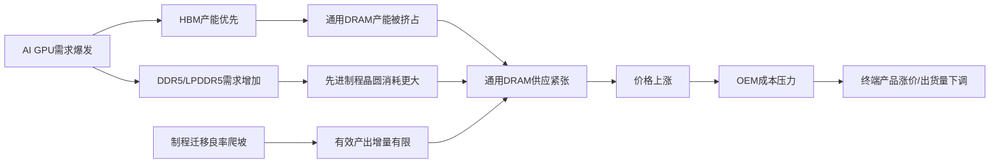
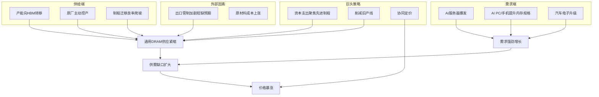

# 内存条价格暴涨原因分析（2025.1–2026.7）

---

## 1. 引言与背景

存储器是现代信息技术的基石。DRAM和NAND Flash不仅决定了智能手机、个人电脑、服务器的性能上限，更在AI算力基础设施中扮演着“数据高速公路”的角色。研究时段2025年1月至2026年7月之所以特殊，在于本轮价格上涨的幅度、持续时间和结构性因素均超越了历史上任何一次存储周期。数据显示，2026年第一季度一般型DRAM合约价环比涨幅高达93%至98%，NAND Flash合约价环比上涨55%至60%[S33: 2026上半年，存储“新周期”](https://www.caiwennews.com/article/1513527.shtml)。这一涨幅甚至超过了2016–2018年由智能手机升级驱动的超级周期和2020–2023年由疫情居家需求推动的上行周期[S8: 存储芯片涨价将延续至2026年](https://pdf.dfcfw.com/pdf/H3_AP202512221805753876_1.pdf)。

价格暴涨对产业链的冲击是多维的：PC和智能手机OEM厂商被迫提价，IDC警告2026年PC市场出货量将减少9%[S10: IDC警告](https://www.ithome.com/0/909/428.htm)；消费者面临更高的换机成本；而存储原厂则迎来创纪录的利润。本报告将从价格走势、供需基本面、技术升级、行业巨头战略、外部环境、细分市场差异、风险因子七个维度，系统剖析本轮涨价的成因与影响。

**2024年价格基线**：2024年存储市场处于下行周期尾声。根据TrendForce和CFM闪存市场的数据，2024年末DRAM总体合约价较2023年高点回落约30–40%，NAND Flash则因供过于求价格接近现金成本线。涨价始于2025年第一季度，以HBM和服务器DDR5为先锋，随后向消费级产品扩散。

---

## 2. 价格走势与数据概览

2025年1月至2026年7月期间，存储价格经历了阶梯式上涨，且不同品类涨幅差异显著。

### 2.1 DRAM总体价格走势

根据DRAMeXchange和TrendForce的数据，2026年2月DRAM均价达到13美元，创下历史新高[S9: 2026年2月DRAM均价13美元](https://finance.sina.com.cn/tech/roll/2026-03-01/doc-inhpnwmk8899549.shtml)。花旗在其最新展望中将2026年DRAM的平均售价（ASP）涨幅预期从53%上调至88%，其中服务器DRAM的ASP预期同比暴涨144%[S31: 存储芯片价格失控！华尔街再调预期](https://finance.sina.com.cn/roll/2026-01-07/doc-inhfnqzt2119262.shtml)。具体来看：

| 时间段 | DRAM合约价格变化（QoQ） | 关键驱动 |
|--------|------------------------|----------|
| 2025 Q4 | 一般型DRAM涨18–23%（上修前为8–13%）[S7: TrendForce上修Q4漲幅](https://tw.stock.yahoo.com/news/trendforce%E4%B8%8A%E4%BF%AEq4%E5%82%B3%E7%B5%B1dram%E6%BC%B2%E5%B9%85%E9%A0%90%E4%BC%B0-%E4%BC%B0ddr5%E5%90%88%E7%B4%84%E5%83%B92026%E5%B9%B4%E4%B8%8A%E6%BC%B2-021209740.html) | 服务器CSP加单 |
| 2026 Q1 | 一般型DRAM合约价季增55–60%[S29: 原厂故意减产！2026开年内存全面上涨](https://www.eet-china.com/mp/a465064.html) | HBM产能挤占+原厂控产 |
| 2026 Q2 | DRAM合约价（含HBM）环比再涨53–58%[S33: 2026上半年，存储“新周期”](https://www.caiwennews.com/article/1513527.shtml) | AI服务器需求支撑 |

### 2.2 分品类价格变化

**DDR5 vs DDR4**：DDR5成为涨价“领头羊”。2025年初至2026年2月，DDR5内存颗粒现货涨幅突破455%，服务器端高端DDR5模组涨幅更超600%，部分高容量产品涨幅突破10倍。消费级DDR5内存模组同期累计涨幅达250–400%。而DDR4涨幅相对温和，但受产能向先进制程转移影响，供应也趋于紧张[S26: 存储涨价后遗症来了](https://finance.sina.com.cn/tech/roll/2026-03-10/doc-inhqnrqs3354751.shtml)。

**HBM**：HBM3e在2025年持续供不应求，合约价大幅上涨。但根据TrendForce预测，2026年HBM3e合约价将转为年减，因供应端产能逐步释放[S7: TrendForce上修Q4漲幅](https://tw.stock.yahoo.com/news/trendforce%E4%B8%8A%E4%BF%AEq4%E5%82%B3%E7%B5%B1dram%E6%BC%B2%E5%B9%85%E9%A0%90%E4%BC%B0-%E4%BC%B0ddr5%E5%90%88%E7%B4%84%E5%83%B92026%E5%B9%B4%E4%B8%8A%E6%BC%B2-021209740.html)。

**NAND Flash**：3D NAND晶圆原厂合约价已连续6个季度上调，2025 Q4至2026 Q1单季度涨幅均超过20%。主流消费级SSD半年内累计上涨50–120%，企业级SSD涨幅更高[S26: 存储涨价后遗症来了](https://finance.sina.com.cn/tech/roll/2026-03-10/doc-inhqnrqs3354751.shtml)。2026年2月NAND价格飙升33.91%[S9: 2026年2月DRAM均价13美元](https://finance.sina.com.cn/tech/roll/2026-03-01/doc-inhpnwmk8899549.shtml)。

### 2.3 关键时间节点

- **2025年Q3**：美光、三星、SK海力士先后上调DRAM合约价，现货价格跟涨[S8: 存储芯片涨价将延续至2026年](https://pdf.dfcfw.com/pdf/H3_AP202512221805753876_1.pdf)。
- **2025年Q4**：TrendForce上修DRAM涨幅预测至18–23%[S7: TrendForce上修Q4漲幅](https://tw.stock.yahoo.com/news/trendforce%E4%B8%8A%E4%BF%AEq4%E5%82%B3%E7%B5%B1dram%E6%BC%B2%E5%B9%85%E9%A0%90%E4%BC%B0-%E4%BC%B0ddr5%E5%90%88%E7%B4%84%E5%83%B92026%E5%B9%B4%E4%B8%8A%E6%BC%B2-021209740.html)。
- **2026年Q1**：一般型DRAM合约价季增55–60%，创下历史最快涨幅纪录[S29: 原厂故意减产！2026开年内存全面上涨](https://www.eet-china.com/mp/a465064.html)。
- **2026年5–7月**：价格持续处于高位，但涨势边际放缓。5月DRAM均价13美元被确认[S9: 2026年2月DRAM均价13美元](https://finance.sina.com.cn/tech/roll/2026-03-01/doc-inhpnwmk8899549.shtml)。

---

## 3. 供需基本面分析

本轮涨价的核心驱动力是**供需缺口的结构性放大**，不同于以往由单一需求侧或供给侧驱动，此次是供需两端共振的结果。

### 3.1 供给端：三重紧锁

**第一重：产能向HBM的战略转移**

三大原厂纷纷将DRAM先进制程产能转向利润更高的HBM。TrendForce指出，2026年DRAM与NAND Flash供应商的资本支出合计将达835亿美元，年增11.6%，但整体位元产出成长仍有限。原因在于投资重心从扩产转向制程技术升级[S4: 記憶體廠2026年資本支出年增11.6%](https://tw.stock.yahoo.com/news/%E8%A8%98%E6%86%B6%E9%AB%942026%E5%B9%B4%E8%B3%87%E6%9C%AC%E6%94%AF%E5%87%BA%E5%B9%B4%E5%A2%9E11-6-%E4%BD%8D%E5%85%83%E6%88%90%E9%95%B7%E6%9C%89%E9%99%90-075429880.html)。SK海力士明确表示聚焦HBM的投资正在创造“良性循环”——资源转向HBM改善了通用DRAM的供需平衡[S17: SK hynix's HBM to Fuel AI Memory Boom](https://news.skhynix.com/2026-market-outlook-focus-on-the-hbm-led-memory-supercycle)。

**第二重：原厂主动控产与减产**

原厂在2024年经历价格低谷后，2025年采取了“产能纪律”策略。美光财报显示，其库存周转天数由139天降至124天，DRAM库存天数已低于目标水平，NAND库存也实现改善[S13: 美光上调2025年服务器总出货量增长预期](https://www.163.com/dy/article/KA7FTGFJ0511DQFI.html)。研究机构直接指出“原厂故意减产”是涨价的关键推手——原厂将产能大规模转移至HBM应用，其余市场供给严重紧缩[S29: 原厂故意减产！2026开年内存全面上涨](https://www.eet-china.com/mp/a465064.html)。

**第三重：制程迁移的产能损耗**

从1α到1β再到1γ制程的迁移，在初期都会导致良率下降和有效产能损失。Yole的报告显示，下一代DRAM技术（HBM和3D DRAM）的研发投入正在分流原本用于通用DRAM的工程资源[S18: Next-Gen DRAM 2026](https://www.yolegroup.com/product/report/next-gen-dram-2026---focus-on-hbm-and-3d-dram)。

### 3.2 需求端：三头并进

**AI服务器主导需求增量**

AI基础设施建设的爆发是需求端最大的结构性变化。IDC预测2026年DRAM收入将接近4186亿美元，主要由HBM需求驱动[S48: Semiconductor Market Forecast 2026](https://www.idc.com/resource-center/blog/semiconductor-market-to-surge-past-the-trillion-dollar-threshold-ai-infrastructure-drives-market-growth)。SK海力士预计HBM市场将以约40%的年增长率增长，到2028年达到1000亿美元[S40: Micron’s earnings spike raises expectations](https://english.hani.co.kr/arti/english_edition/e_business/1235575.html)。每个AI GPU需要搭载6–8颗HBM，而HBM单位晶圆消耗量是DDR5的3倍以上[S12: TrendForce：DRAM 市场与技术概览2025-2026](https://cloud.tencent.com/developer/article/2574397)。

**PC与智能手机复苏叠加AI化**

尽管PC市场整体出货量在2026年预期下降9%[S10: IDC警告](https://www.ithome.com/0/909/428.htm)，但AI PC的内存配置大幅提升。Canalys预计2026年AI PC渗透率将突破50%[S11: 2026展望：算力高景气延续](https://www.cmbi.com.hk/upload/202512/20251211566527.pdf)。每台AI PC的DRAM搭载量从16GB提升至32GB甚至更高，NAND SSD容量也从512GB向1–2TB升级。智能手机方面，旗舰机型AI功能对高速传输需求维持刚性，LPDDR5X的普及推动了位元消耗[S14: AI服务器需求支撑2026年第二季度存储器合约价上行](https://www.trendforce.cn/presscenter/news/20260331-12993.html)。

**汽车电子与工业需求回温**

汽车领域，ADAS和AI增强型座舱体验对内存和存储容量提出了更高要求。美光2025财季数据显示汽车和工业需求强劲，且DDR5和LPDDR5产品的采用率不断提高[S15: 美光上调2025年服务器总出货量增长预期](https://view.inews.qq.com/a/20250924A02RTY00)。

### 3.3 供需缺口定量测算

由于上述供需因素，位元供需缺口在2025 Q3至2026 Q2期间持续扩大。TrendForce的2026年第二季度报告显示，AI服务器需求有效抵消了消费端疲软，DRAM合约价继续上行[S36: DRAM Market Bulletin - May 6, 2026](https://www.trendforce.com/research/download/RP260506QK)。

---

## 4. 技术升级的影响

技术升级是加剧供需失衡的深层结构性因素。

### 4.1 DDR5渗透率快速提升

DDR5在服务器中的渗透率在2025年底已超过50%[S39: High Bandwidth Memory Market Size](https://www.mordorintelligence.com/industry-reports/high-bandwidth-memory-market)。DDR5的裸晶尺寸比DDR4大约30–40%，意味着相同晶圆数量下可产出的DDR5颗粒数更少——这一“晶圆消耗效应”直接推高了单位成本。同时，DDR5的制造良率在初期低于成熟制程的DDR4，进一步压缩了有效产出。

### 4.2 HBM需求的指数级爆发

SK海力士在2026年市场展望中指出，聚焦HBM的投资正在改善通用DRAM的供需平衡——资源被HBM大量占用，通用DRAM供应自然趋紧[S17: SK hynix's HBM to Fuel AI Memory Boom](https://news.skhynix.com/2026-market-outlook-focus-on-the-hbm-led-memory-supercycle)。

HBM的制造需要采用硅通孔（TSV）技术，这不仅额外增加了后道封装环节，还需要专门的测试和堆叠设备。TSV产能的扩张速度决定了HBM的供应上限。SK海力士和美光都在积极扩充TSV产能[S12: TrendForce：DRAM 市场与技术概览2025-2026](https://cloud.tencent.com/developer/article/2574397)。

### 4.3 先进制程迁移中的良率挑战

从1α到1β再到1γ的工艺迭代，每次升级都会经历数月甚至数年的良率爬坡期。美光和三星在1β制程的商用化过程中均报告过短期的良率低于预期。Yole的下一代DRAM报告专门分析了制程缩放面临的物理极限挑战[S18: Next-Gen DRAM 2026](https://www.yolegroup.com/product/report/next-gen-dram-2026---focus-on-hbm-and-3d-dram)。这导致即使原厂大幅增加资本支出，有效位元产出增长的转化效率也在下降。

### 4.4 技术升级对成本的影响传导

---

## 5. 行业巨头市场策略与产能调整

**三星、SK海力士、美光**三大原厂在2025–2026年的策略高度趋同：削减旧产线、转向HBM、严控供给，形成了事实上的“协同涨价”。

### 5.1 资本开支聚焦HBM而非扩张

2026年DRAM与NAND供应商资本支出合计达835亿美元，年增11.6%，但位元成长有限[S4: 記憶體廠2026年資本支出年增11.6%](https://tw.stock.yahoo.com/news/%E8%A8%98%E6%86%B6%E9%AB%942026%E5%B9%B4%E8%B3%87%E6%9C%AC%E6%94%AF%E5%87%BA%E5%B9%B4%E5%A2%9E11-6-%E4%BD%8D%E5%85%83%E6%88%90%E9%95%B7%E6%9C%89%E9%99%90-075429880.html)。资本开支的增长主要被HBM封装测试设施、洁净室建设和制程工具升级所消耗，而非用于新增通用DRAM产能。

**美光**：2026财年资本支出预计超过250亿美元（较上次估算的200亿美元大幅上调），主要用于洁净室设施、收购的力晶铜锣厂及美国晶圆厂。铜锣厂预计2028财年出货，爱达荷州晶圆厂预计2027年中投产[S6: 美光最新财报](https://www.chinaflashmarket.com/a/183713)。美光还计划持续投资日本生产基地以满足未来需求[S13: 美光上调2025年服务器总出货量增长预期](https://www.163.com/dy/article/KA7FTGFJ0511DQFI.html)。

**三星**：2025年存储器业务全年销售额达104.1万亿韩元，同比增长23%。三星预计2026年存储器领域资本支出将增加，但强调重点在HBM和先进节点[S5: 三星与SK海力士最新财报](https://finance.sina.com.cn/roll/2026-01-29/doc-inhiyffy3162718.shtml)。

**SK海力士**：作为HBM市场的领导者，SK海力士的HBM产能扩张最为激进。其在M16工厂新建的HBM产线预计2027年贡献显著产出。

### 5.2 旧产线削减与产品结构优化

三大原厂同步削减DDR4和NAND浮栅型产品的产能。美光在2025年8月宣布投资弗吉尼亚州工厂，专门用于满足客户对DDR4和LPDDR4的传统需求[S15: 美光上调2025年服务器总出货量增长预期](https://view.inews.qq.com/a/20250924A02RTY00)——这一表态间接证实了传统产能正在被主动压缩。

花旗的分析师指出，市场将进入“极其剧烈的卖方市场，定价权将完全掌握在三星等存储巨头手中”[S30: 存储芯片价格失控！华尔街再调预期](https://wallstreetcn.com/articles/3762731)。

### 5.3 定价策略的协同效应

三大原厂在2025年下半年各自发布涨价函后，均在后续季度中持续上调合约价。TrendForce观察到，供应商在收到CSP加单需求后，调升报价的意愿明显提高[S7: TrendForce上修Q4漲幅](https://tw.stock.yahoo.com/news/trendforce%E4%B8%8A%E4%BF%AEq4%E5%82%B3%E7%B5%B1dram%E6%BC%B2%E5%B9%85%E9%A0%90%E4%BC%B0-%E4%BC%B0ddr5%E5%90%88%E7%B4%84%E5%83%B92026%E5%B9%B4%E4%B8%8A%E6%BC%B2-021209740.html)。这种“公开涨价、相互验证”的策略降低了各自的价格竞争风险。

---

## 6. 外部环境因素

### 6.1 地缘政治：芯片出口管制

美国对华芯片出口管制在2025–2026年持续加码。2022年的管控主要针对中国境内实体，2023年将限制范围扩大到第三国，2024年则将焦点延伸至HBM——美国BIS发现“内存带宽对AI系统性能的关键作用”此前被低估[S1: 美国政府2022年至2024年的芯片出口管制](https://en.iiss.pku.edu.cn/__local/F/A0/C0/491A5FDC43D0B127C7422768B04_AA63B846_8E9EB.pdf)。

2026年，特朗普政府进一步调整对华半导体出口政策。根据2026年1月的三项行政行动，美国对中国的先进芯片出口需满足特定条件，包括：必须首先进口到美国、接受额外关税（针对某些芯片征税25%）、且受制于50%的销量上限[S45: The Trump Administration's New Tariffs](https://www.gibsondunn.com/trump-administration-new-tariffs-on-and-export-licensing-requirements-for-advanced-semiconductors-create-challenging-new-cross-currents-new-opportunities-for-us-manufacturers)。这些措施实质上切断了对华高端存储芯片的顺畅供应，迫使中国本土AI芯片厂商转向HBM等产品的替代方案受限，加剧了全球HBM的争夺。

然而，值得注意的反转是：2026年中美在半导体和稀土矿产方面的出口管制争端后达成了休战协议，降低了双边关税并暂停了出口管制[S21: 世界经济展望更新](https://www.elibrary.imf.org/display/book/9798229032742/9798229032742.pdf)。这意味着地缘政治因素在2026年下半年可能边际缓和。

### 6.2 原材料成本上涨

硅料、黄金、铜、特种化学品等半导体制造关键原材料的价格在2025–2026年均有所上涨。虽然存储器原厂自有晶圆厂的垂直整合结构可部分对冲成本压力，但定制化化学品（如光刻胶、蚀刻气体）的供应紧张和涨价仍然传导至晶圆成本端。

### 6.3 宏观经济：通胀、利率与消费电子需求

2026年全球经济增长预测为3%，较2025年进一步放缓[S24: 2025—2026年世界经济形势分析与展望](https://www.cpifa.org/cms/book/302)。IMF预计美国2026年经济增长2.6%[S22: IMF预计2026年美国经济增长2.6%](https://www.cls.cn/detail/2295311)。高通胀和利率环境抑制了消费者的可支配支出，IDC预测2026年智能手机出货量下降约13.9%[S47: Rising Memory Prices Weigh on Consumer Markets](https://www.trendforce.com/presscenter/news/20251117-12784.html)。

但值得注意的是，**消费端的疲软并未削弱整体需求**，因为AI基础设施的投资周期与消费周期脱钩。美国大力推进半导体制造本土化的政策（包括CHIPS法案的持续实施）也在推动对HBM等本土制造存储产品的需求，从而部分抵消了消费端的拖累[S23: EFG_Outlook_2026_SC](https://www.efginternational.com/doc/jcr:01c06c3f-8da9-4847-8b5d-c5f03818b409/EFG_Outlook_2026_DE.pdf/lang:zh_CN/EFG_Outlook_2026_SC.pdf)。

---

## 7. 不同类型内存价格变动差异

### 7.1 DRAM vs NAND：涨幅差异与原因

在2026年第一季度，一般型DRAM合约价环比涨幅达到55–60%，而NAND Flash合约价环比上涨33–38%[S29: 原厂故意减产！2026开年内存全面上涨](https://www.eet-china.com/mp/a465064.html)。花旗对2026年全年ASP涨幅预测为DRAM涨88%、NAND涨74%[S31: 存储芯片价格失控！华尔街再调预期](https://finance.sina.com.cn/roll/2026-01-07/doc-inhfnqzt2119262.shtml)。

**原因分析**：
- **DRAM涨得更快更猛**：HBM对DRAM产能的挤占效应远大于AI训练对NAND的拉动。DRAM容量规格提升（DDR5→HBM）导致的晶圆消耗效率下降更显著。
- **NAND库存去化节奏慢**：NAND Flash在2023–2024年经历了更严重的供过于求，原厂库存清理速度慢于DRAM，初始价格基数更高，因此边际涨幅相对温和。
- **供给缺口差异**：NAND Flash的eMMC/UFS与Enterprise SSD在部分制程上高度重叠，但单位利润远低于后者，导致供给缺口成为全产品线之冠[S14: AI服务器需求支撑2026年第二季度存储器合约价上行](https://www.trendforce.cn/presscenter/news/20260331-12993.html)。

### 7.2 服务器 vs 消费级 vs 移动端 vs HBM

| 细分市场 | 2025年初–2026年上半年累计涨幅 | 核心特征 |
|----------|-------------------------------|----------|
| 服务器DDR5 | 超600%（高端模组）[S26: 存储涨价后遗症来了](https://finance.sina.com.cn/tech/roll/2026-03-10/doc-inhqnrqs3354751.shtml) | CSP加单强势，原厂优先供应 |
| 消费级DDR5 | 250–400%[S26: 存储涨价后遗症来了](https://finance.sina.com.cn/tech/roll/2026-03-10/doc-inhqnrqs3354751.shtml) | AI PC拉动，但供应排挤严重 |
| 移动端LPDDR5X | 涨幅约10–15%每季度[S7: TrendForce上修Q4漲幅](https://tw.stock.yahoo.com/news/trendforce%E4%B8%8A%E4%BF%AEq4%E5%82%B3%E7%B5%B1dram%E6%BC%B2%E5%B9%85%E9%A0%90%E4%BC%B0-%E4%BC%B0ddr5%E5%90%88%E7%B4%84%E5%83%B92026%E5%B9%B4%E4%B8%8A%E6%BC%B2-021209740.html) | 智能手机出货量下滑，需求弹性弱 |
| HBM3e | 合约价2025年大涨，2026年预计转年减[S7: TrendForce上修Q4漲幅](https://tw.stock.yahoo.com/news/trendforce%E4%B8%8A%E4%BF%AEq4%E5%82%B3%E7%B5%B1dram%E6%BC%B2%E5%B9%85%E9%A0%90%E4%BC%B0-%E4%BC%B0ddr5%E5%90%88%E7%B4%84%E5%83%B92026%E5%B9%B4%E4%B8%8A%E6%BC%B2-021209740.html) | 长期合约锁定价格，新增产能逐步释放 |
| 服务器SSD | 累计涨幅超100%[S26: 存储涨价后遗症来了](https://finance.sina.com.cn/tech/roll/2026-03-10/doc-inhqnrqs3354751.shtml) | AI训练数据存储需求推动 |
| 消费级SSD | 累计涨幅50–120%[S26: 存储涨价后遗症来了](https://finance.sina.com.cn/tech/roll/2026-03-10/doc-inhqnrqs3354751.shtml) | 原厂控产叠加服务器eSSD排挤 |

### 7.3 核心差异解释

**服务器DRAM涨幅最大**的原因在于：三大原厂将HBM优先供应后，剩余的DDR5产能已被CSP客户通过长期协议锁定，PC和消费电子厂商实际上面临“被迫竞价”的处境。TrendForce明确指出，4Q25 PC DRAM合约价飙升的原因是供应商优先满足服务器客户，PC OEM获得的分配量持平甚至减少，导致他们不得不从模组厂寻求货源[S35: DRAM Contract Price Nov. 2025](https://www.trendforce.com/research/download/RP251128YJ)。

**HBM定价模式特殊**：HBM以前期长协合同为主，价格灵活性低。当新增产能（如美光铜锣厂2028财年出货、新加坡HBM封装厂2027年贡献产能）开始释放后，HBM价格预期在2027年松动[S41: Micron Financial Results](https://investors.micron.com/static-files/9c0becf5-df56-4eec-bd67-453dda68b273)。

---

## 8. 风险与不确定性

### 8.1 需求突然下滑风险

AI基础设施投资存在周期性。如果AI模型训练的效率提升超出预期（例如新型架构降低内存需求），或北美CSP资本支出出现季度性缩减，HBM的需求增速可能放缓。IDC已下调2026年PC出货量预期（-9%），智能手机出货量预计下降约13.9%[S47: Rising Memory Prices Weigh on Consumer Markets](https://www.trendforce.com/presscenter/news/20251117-12784.html)。若消费端持续萎缩而AI投资趋稳，需求支撑可能出现断档。

### 8.2 产能过快恢复风险

原厂大幅扩张资本支出的产能将在2027–2028年陆续释放。美光预计2027财年资本支出将继续大幅增长，其中建设相关支出同比增加超100亿美元[S6: 美光最新财报](https://www.chinaflashmarket.com/a/183713)。若HBM需求在2027年前后未能维持高增长，行业可能从“供应短缺”迅速转向“供应过剩”，复制2019年存储价格雪崩的轨迹。

### 8.3 地缘政治升级风险

尽管2026年上半年中美达成了休战协议[S21: 世界经济展望更新](https://www.elibrary.imf.org/display/book/9798229032742/9798229032742.pdf)，但美国对华“去风险化”的长期战略未变[S23: EFG_Outlook_2026_SC](https://www.efginternational.com/doc/jcr:01c06c3f-8da9-4847-8b5d-c5f03818b409/EFG_Outlook_2026_DE.pdf/lang:zh_CN/EFG_Outlook_2026_SC.pdf)。新的出口管制升级或关税措施可能再次冲击全球供应链，导致分岔加剧，造成区域性的价格极端波动。

### 8.4 替代技术威胁

CXL（Compute Express Link）内存池化技术、Chiplet架构、3D DRAM等新兴技术路线可能在未来改变内存市场格局。Yole对3D DRAM的报告显示，该技术正处于研发突破的关键期[S18: Next-Gen DRAM 2026](https://www.yolegroup.com/product/report/next-gen-dram-2026---focus-on-hbm-and-3d-dram)。此外，存储级内存（SCM）如Intel Optane退出后的市场真空，可能被其他新型非易失性内存技术填补。虽然这些替代技术在2026年内对主流DRAM市场的冲击有限，但投资者需关注技术路线多元化的长期影响。

### 8.5 下游库存积压风险

美光2025财季末库存总额84亿美元，环比下降3.72亿美元，库存周转天数124天，DRAM库存天数已低于目标水平[S13: 美光上调2025年服务器总出货量增长预期](https://www.163.com/dy/article/KA7FTGFJ0511DQFI.html)。这表明原厂库存较为健康。但下游OEM客户因恐慌性锁货而积累了较高库存。IDC报告指出，PC和智能手机厂商在2025年Q4大幅增加出货量以“应对涨价”后，渠道库存可能面临去化压力[S46: Memory Shortage Crisis Hits PCs and Smartphones](https://www.idc.com/resource-center/blog/higher-asps-lower-unit-volumes-how-the-memory-crisis-is-reshaping-the-pc-and-smartphone-outlook)。一旦需求低于预期，去库存过程可能快速拉低合约价。

---

## 9. 结论与未来展望

### 9.1 核心驱动因素总结

本轮内存条价格暴涨是**供需结构性缺口、技术升级的产能损耗、三大巨头的协同策略、以及外部地缘政治冲击**四力平行的复合结果：

**核心因果链**：AI需求爆发 → HBM产能优先 → 通用DRAM被严重挤占 → 原厂顺势控产提价 → 出口管制加剧短缺预期 → 价格创历史新高 → 下游成本压力传导 → 终端出货量预期下调。

### 9.2 2026年下半年趋势展望

**短期（2026年Q3–Q4）**：
- 价格仍将维持高位，但季度涨幅将从55–60%显著收窄至个位数。TrendForce 2026年Q2报告显示，现货市场在供给方提价后已出现买方观望情绪[S36: DRAM Market Bulletin - May 6, 2026](https://www.trendforce.com/research/download/RP260506QK)。
- HBM3e价格可能率先持平或小幅走弱，因新增产能开始释放。
- 服务器DRAM价格将继续获得CSP长期合同的支撑；消费级DRAM和NAND受终端需求走弱影响，涨幅空间有限。
- Computex 2026上各厂商的新一代HBM4路线图和产能规划将成为判断供应拐点的关键信号。

**中长期（2027年）**：
- 三大原厂2027年的资本支出明确聚焦HBM和先进制程，预期每年新增通用DRAM位元供应增速有限[S6: 美光最新财报](https://www.chinaflashmarket.com/a/183713)。
- 若北美CSP的AI资本支出增速放缓，HBM供需可能在2027年下半年接近平衡。
- 消费者市场的内存价格将在2027年初面临实质性下行压力，OEM去库存周期可能拉开价格调整序幕。

### 9.3 对投资者的启示

1. **关注HBM产能爬坡速度**：SK海力士和美光HBM产能的投资回报率是核心指标。SK海力士凭借先发优势在HBM市场占据有利地位，而美光的HBM市场份额将从2025年的约11%持续提升[S20: 美光科技(买入，目标价)](https://pdf.dfcfw.com/pdf/H3_AP202410291640560675_1.pdf)。
2. **警惕周期见顶信号**：关键监测指标包括：①下游PC和手机厂商库存天数升至警戒线（>8周）；②NAND wafer月度报价出现连续2个月环比下跌；③原厂季度合约价谈判中涨幅缩至5%以下；④HBM长协订单出现削减。
3. **多元化布局对冲风险**：关注CXL、3D DRAM等替代技术的突破进度，以及中国本土存储厂商（如长鑫存储CXMT）的扩产动态。CXMT的月产能已接近美光，良品率规模提升将改变全球供应格局[S12: TrendForce：DRAM 市场与技术概览2025-2026](https://cloud.tencent.com/developer/article/2574397)。

### 9.4 对供应链参与者的建议

- **OEM厂商**：在2026年下半年可适度降低安全库存水位，利用现货与合约价差优化采购成本。积极与CSP客户协商HBM通用DRAM混合供应协议。
- **渠道与模组厂**：NAND Flash wafer因原厂出货优先级最低而供应稀缺，但模组厂面临成本与销量双重困境[S14: AI服务器需求支撑2026年第二季度存储器合约价上行](https://www.trendforce.cn/presscenter/news/20260331-12993.html)，应控制备货风险。
- **终端品牌商**：AI PC和AI手机的内存规格竞赛应兼顾成本可控性，避免因过度堆料压缩利润空间。

---

**关键监测指标清单**：

| 指标 | 当前水平（截至2026年7月） | 转折信号 |
|------|---------------------------|----------|
| 一般型DRAM合约价QoQ | 2026 Q1: +55–60%, Q2: +53–58%[S33] | 降至10%以下意味着供需再平衡 |
| 美光库存周转天数 | 124天（DRAM低于目标）[S13] | 回升至140天以上为过剩信号 |
| 三星存储器资本支出 | 2026年预计增加，具体待披露[S5] | 单季设备支出环比增速放缓 |
| DDR5 vs DDR4价格比 | DDR5溢价收窄但绝对值仍高 | 若DDR5溢价回到1.2倍以下，表示技术转换完成 |
| HBM3e合约价年增率 | 2026年预期转年减[S7] | 若HBM价格全面下降，通用DRAM供应压力缓解 |
| AI服务器出货量 | 保持高增长 | 同比增速从>50%降至<30% |

---

*本报告数据截止至2026年7月20日。所有预测均为基于现有信息的条件性判断，实际市场走势可能因宏观经济、地缘政治、技术突破等不确定因素而偏离。*

## 参考来源

- [S1: 美国政府2022 年至2024 年的芯片出口管制](https://en.iiss.pku.edu.cn/__local/F/A0/C0/491A5FDC43D0B127C7422768B04_AA63B846_8E9EB.pdf)
- [S2: 美国对华出口管制：2025年执法新态与2026年合规前瞻（下篇）2026年美国对华出口管制趋势研判与企业合规策略](https://www.chinalawinsight.com/2026/04/articles/uncategorized/%E7%BE%8E%E5%9B%BD%E5%AF%B9%E5%8D%8E%E5%87%BA%E5%8F%A3%E7%AE%A1%E5%88%B6%EF%BC%9A2025%E5%B9%B4%E6%89%A7%E6%B3%95%E6%96%B0%E6%80%81%E4%B8%8E2026%E5%B9%B4%E5%90%88%E8%A7%84%E5%89%8D%E7%9E%BB%EF%BC%88-2)
- [S3: 硅幕”已至：美国对华人工智能出口管制与中国应对](https://ciss.tsinghua.edu.cn/info/zmgx/9011)
- [S4: 記憶體廠2026年資本支出年增11.6% 位元成長有限](https://tw.stock.yahoo.com/news/%E8%A8%98%E6%86%B6%E9%AB%94%E5%BB%A02026%E5%B9%B4%E8%B3%87%E6%9C%AC%E6%94%AF%E5%87%BA%E5%B9%B4%E5%A2%9E11-6-%E4%BD%8D%E5%85%83%E6%88%90%E9%95%B7%E6%9C%89%E9%99%90-075429880.html)
- [S5: 三星与SK海力士最新财报：预计2026年均将扩大资本支出|sk海力士_新浪财经_新浪网](https://finance.sina.com.cn/roll/2026-01-29/doc-inhiyffy3162718.shtml)
- [S6: 美光最新财报：DRAM、NAND价格飙升65%、75%，2026财年资本支出上调至超250亿美元_CFM闪存市场](https://www.chinaflashmarket.com/a/183713)
- [S7: TrendForce上修Q4傳統DRAM漲幅預估，估DDR5合約價 ...](https://tw.stock.yahoo.com/news/trendforce%E4%B8%8A%E4%BF%AEq4%E5%82%B3%E7%B5%B1dram%E6%BC%B2%E5%B9%85%E9%A0%90%E4%BC%B0-%E4%BC%B0ddr5%E5%90%88%E7%B4%84%E5%83%B92026%E5%B9%B4%E4%B8%8A%E6%BC%B2-021209740.html)
- [S8: 存储芯片涨价将延续至2026 年](https://pdf.dfcfw.com/pdf/H3_AP202512221805753876_1.pdf)
- [S9: 2026年2月DRAM均价13美元，NAND价格飙升33.91%](https://finance.sina.com.cn/tech/roll/2026-03-01/doc-inhpnwmk8899549.shtml)
- [S10: IDC 警告：2026 年 PC 市场出货量将减少 9%，内存短缺将持续数年 - IT之家](https://www.ithome.com/0/909/428.htm)
- [S11: 2026 展望：算力高景气延续，关注端侧AI 创新机遇](https://www.cmbi.com.hk/upload/202512/20251211566527.pdf)
- [S12: TrendForce：DRAM 市场与技术概览2025-2026 - 腾讯云](https://cloud.tencent.com/developer/article/2574397)
- [S13: 美光上调2025年服务器总出货量增长预期，预计明年行业DRAM供应将趋于紧张！|财季|财年|dram|美光科技_网易订阅](https://www.163.com/dy/article/KA7FTGFJ0511DQFI.html)
- [S14: TrendForce集邦咨询: AI服务器需求支撑2026年第二季度存储器合约价上行，CSP借长期协议锁定供货-集邦咨询](https://www.trendforce.cn/presscenter/news/20260331-12993.html)
- [S15: 美光上调2025年服务器总出货量增长预期，预计明年行业DRAM供应将趋于紧张！_腾讯新闻](https://view.inews.qq.com/a/20250924A02RTY00)
- [S16: 深度剖析HBM千亿蓝海，AI算力激战下供需新格局](http://www.cgws.com/cczq/ggdt/ccyj/202508/P020250828307261620941.pdf)
- [S17: 2026 Market Outlook: SK hynix's HBM to Fuel AI Memory Boom](https://news.skhynix.com/2026-market-outlook-focus-on-the-hbm-led-memory-supercycle)
- [S18: Next-Gen DRAM 2026 – Focus on HBM and 3D DRAM](https://www.yolegroup.com/product/report/next-gen-dram-2026---focus-on-hbm-and-3d-dram)
- [S19: Memory Market Surges Beyond Expectations: Almost $200B in 2025, Driven by HBM and AI - Edge AI and Vision Alliance](https://www.edge-ai-vision.com/2025/06/memory-market-surges-beyond-expectations-almost-200-billion-in-2025-driven-by-hbm-ai)
- [S20: PDF  美光科技(MU US, 买入, 目标价](https://pdf.dfcfw.com/pdf/H3_AP202410291640560675_1.pdf)
- [S21: 世界经济展望更新 - IMF eLibrary](https://www.elibrary.imf.org/display/book/9798229032742/9798229032742.pdf)
- [S22: IMF预计2026年美国经济增长2.6%](https://www.cls.cn/detail/2295311)
- [S23: EFG_Outlook_2026_SC.pdf](https://www.efginternational.com/doc/jcr:01c06c3f-8da9-4847-8b5d-c5f03818b409/EFG_Outlook_2026_DE.pdf/lang:zh_CN/EFG_Outlook_2026_SC.pdf)
- [S24: 2025—2026年世界经济形势分析与展望](https://www.cpifa.org/cms/book/302)
- [S25: 世界经济展望](https://www.elibrary.imf.org/downloadpdf/display/book/9798400257445/9798400257445.pdf)
- [S26: 存储涨价后遗症来了|内存_新浪科技_新浪网](https://finance.sina.com.cn/tech/roll/2026-03-10/doc-inhqnrqs3354751.shtml)
- [S27: 存储涨价后遗症来了-钛媒体官方网站](https://www.tmtpost.com/7903062.html)
- [S28: 存储芯片“超级周期”来临涨价潮预计延续至2026年](https://www.stcn.com/article/detail/3395195.html)
- [S29: 原厂故意减产！2026开年内存、SSD各类存储价格全面上涨：最高涨幅60%-电子工程专辑](https://www.eet-china.com/mp/a465064.html)
- [S30: 存储芯片价格失控！华尔街再调预期：2026年DRAM或暴涨 ...](https://wallstreetcn.com/articles/3762731)
- [S31: 存储芯片价格失控！华尔街再调预期：2026年DRAM或暴涨 ...](https://finance.sina.com.cn/roll/2026-01-07/doc-inhfnqzt2119262.shtml)
- [S32: 美光财报会拆解半导体供需：DRAM/NAND库存下降 HBM成增长核心](https://www.cls.cn/detail/2154342)
- [S33: 2026上半年，存储“新周期”：AI算力重塑供求关系，国产替代加速突围 - 财闻](https://www.caiwennews.com/article/1513527.shtml)
- [S34: When Will RAM Prices Drop? Global Memory Market](https://www.bacloud.com/en/blog/230/when-will-ram-prices-drop-global-memory-market-outlook-20242026.html)
- [S35: DRAM Contract Price Nov. 2025 | TrendForce](https://www.trendforce.com/research/download/RP251128YJ)
- [S36: DRAM Market Bulletin - May 6, 2026 | TrendForce](https://www.trendforce.com/research/download/RP260506QK)
- [S37: Global DRAM Market Research Report 2026-2036](https://finance.yahoo.com/sectors/technology/articles/global-dram-market-research-report-094700134.html)
- [S38: Dynamic Random Access Memory Market Size & Share 2031](https://www.mordorintelligence.com/industry-reports/dynamic-random-access-memory-market)
- [S39: High Bandwidth Memory Market Size, Growth, Forecast & ...](https://www.mordorintelligence.com/industry-reports/high-bandwidth-memory-market)
- [S40: Micron’s earnings spike raises expectations for Korea’s Samsung, SK Hynix in 2026](https://english.hani.co.kr/arti/english_edition/e_business/1235575.html)
- [S41: Financial results - Micron Investor Relations](https://investors.micron.com/static-files/9c0becf5-df56-4eec-bd67-453dda68b273)
- [S42: Financial results - Micron Investor Relations](https://investors.micron.com/static-files/530bd7ed-a8c8-4687-af4a-8c129f740e09)
- [S43: US chip export controls have cooled down](https://eastasiaforum.org/2026/03/11/us-chip-export-controls-have-cooled-down)
- [S44: Presidential 2025 Tariff Actions: Timeline and Status](https://www.congress.gov/crs-product/R48549)
- [S45: The Trump Administration's New Tariffs on and Export ...](https://www.gibsondunn.com/trump-administration-new-tariffs-on-and-export-licensing-requirements-for-advanced-semiconductors-create-challenging-new-cross-currents-new-opportunities-for-us-manufacturers)
- [S46: IDC - Memory Shortage Crisis Hits PCs and Smartphones](https://www.idc.com/resource-center/blog/higher-asps-lower-unit-volumes-how-the-memory-crisis-is-reshaping-the-pc-and-smartphone-outlook)
- [S47: Rising Memory Prices Weigh on Consumer Markets; 2026 ...](https://www.trendforce.com/presscenter/news/20251117-12784.html)
- [S48: Semiconductor Market Forecast 2026: The AI Supercycle ...](https://www.idc.com/resource-center/blog/semiconductor-market-to-surge-past-the-trillion-dollar-threshold-ai-infrastructure-drives-market-growth)
